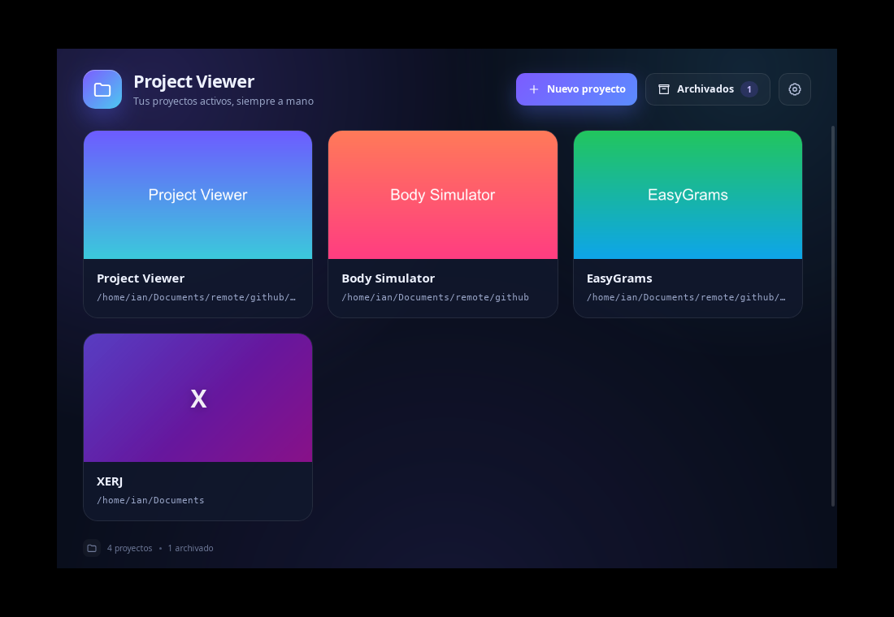
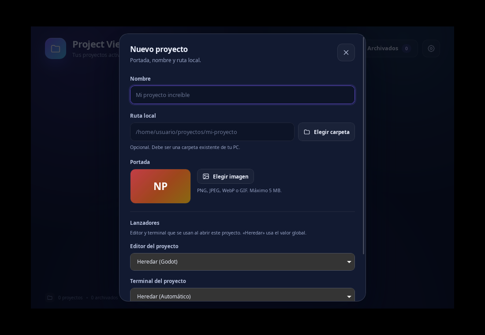
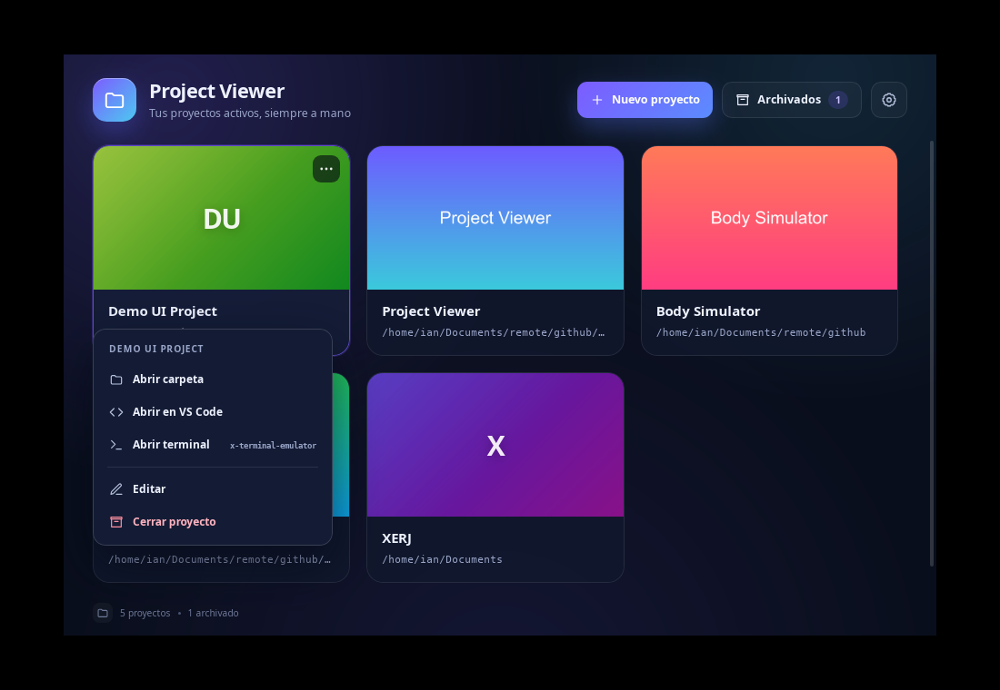

# Project Viewer

A small Linux desktop dashboard for the local projects you are working on. It opens in a compact window, shows active projects in a grid, and lets you open their folders, edit their metadata, or archive them when you are done.

## Current scope

- **Linux only** for this first version (GNOME/Wayland tested).
- Tauri 2 + React 19 + TypeScript + Vite.
- Local-only data: no accounts, network calls, telemetry, or cloud sync.
- Manual project list; folders are not auto-discovered.
- Planned later: Windows/macOS support.

## Features

- Window with a responsive grid of active projects (cover, name, local path).
- Create and edit projects in a modal: cover image, name, local path, and launcher preferences.
- Cover images (PNG, JPEG, WebP, GIF up to 5 MB) are copied into the app data directory.
- Global defaults and per-project overrides for the editor and terminal:
  - Editors: automatic, VS Code, Godot, or a custom command.
  - Terminals: automatic, GNOME Terminal, Konsole, Xfce Terminal, kitty, Alacritty, or a custom command.
- Card action menu:
  - Open the project folder in the system file manager.
  - Open the folder in the configured editor (label adapts to VS Code, Godot, or custom).
  - Open the configured terminal in the project folder.
  - Edit or close the project.
- Archive view with restore and permanent delete.
- Projects persist in `projects.json`; corrupt catalogs are backed up and recovered.
- Start at login through XDG Autostart, with a settings toggle.
- Single instance: opening the app again focuses the existing window.

## Screenshots



| New project | Action menu |
| --- | --- |
|  |  |

## Requirements

- Ubuntu 26.04 (or a compatible Debian/Ubuntu) with GNOME/Wayland.
- Node.js 22.22+ and npm.
- Rust 1.99+ with Cargo. On this machine Rust lives in `~/.cargo/bin`; load it in non-interactive shells with:

  ```bash
  source ~/.cargo/env
  ```

- Tauri Linux build dependencies:

  ```bash
  sudo apt-get install -y \
    libwebkit2gtk-4.1-dev \
    libayatana-appindicator3-dev \
    librsvg2-dev \
    build-essential
  ```

- Desktop tools used by the action menu: `xdg-open`, optionally `code` and `godot`/`godot4`, and a direct terminal such as `gnome-terminal`, `konsole`, `xfce4-terminal`, `kitty`, or `alacritty`. The `x-terminal-emulator` wrapper is intentionally not used because it drops the working-directory argument.

## Development

```bash
npm install
npm run tauri dev
```

The first build compiles the Rust backend and can take a few minutes. Vite serves the frontend on `http://localhost:1420` and Tauri opens the window.

Useful commands:

```bash
npm run typecheck                     # TypeScript checks
npm run test                          # Vitest + Testing Library
npm run test:watch                    # Tests in watch mode
npm run build                         # TypeScript + Vite production build
```

Rust checks run from `src-tauri/`:

```bash
cd src-tauri
source ~/.cargo/env
cargo test
cargo clippy -- -D warnings
```

During development you can isolate the catalog from your real data:

```bash
PROJECT_VIEWER_DATA_DIR=/tmp/project-viewer-dev npm run tauri dev
```

The override is only honored in debug builds. The asset protocol is scoped to the real app data directory, so covers are not visible when using an override; use the default data directory to test cover rendering.

## Usage

1. Start the app with `npm run tauri dev` or the installed `project-viewer` binary.
2. Click **Nuevo proyecto**, write a name, optionally pick a local folder and a cover image, and choose the editor/terminal for that project (or leave **Heredar**), then save.
3. Click any card to open its action menu:
   - **Abrir carpeta** opens the folder in the system file manager.
   - **Abrir en VS Code**, **Abrir en Godot**, or **Abrir con editor personalizado** opens the configured editor (disabled if the tool is not installed).
   - **Abrir terminal (GNOME Terminal)** (or the configured terminal) opens the configured terminal in that folder (disabled if no compatible terminal is found).
   - **Editar** changes the name, path, cover, or launcher overrides.
   - **Cerrar proyecto** archives the project.
4. Use **Archivados** to restore a project or delete it permanently. Deleting only removes the catalog entry and its copied cover; the real folder is never touched.
5. Open the gear menu to configure the global default editor/terminal and to enable or disable **Iniciar al iniciar sesión**. In development mode autostart is disabled; it becomes available in an installed build.

## Data location

The app stores data in Tauri's app data directory, normally:

```text
~/.local/share/com.ian.projectviewer/
├── projects.json     # catalog, including per-project launcher overrides
├── settings.json     # autostart and global launcher defaults
└── covers/           # copied cover images and temporary staged files
```

See [`docs/catalog.md`](docs/catalog.md) for the JSON format, validation rules, and recovery behavior.

## Actions and tool detection

The backend searches `PATH`, `/usr/bin`, `/usr/local/bin`, `~/.local/bin`, and `/snap/bin`:

| Action | Tool / candidates |
| --- | --- |
| Open folder | `xdg-open` |
| Open in editor | `code` (VS Code), `godot`/`godot4` (Godot), or a custom command template |
| Open terminal | `gnome-terminal`, `konsole`, `xfce4-terminal`, `kitty`, `alacritty`, or a custom command template |

Paths are passed as a single process argument; the app never runs them through a shell. If a tool is missing, its menu item is disabled and explains why. If a project folder disappears after saving, the open action shows an error and asks you to edit the path.

### Launcher configuration

- **Global defaults** live in the gear menu: editor, terminal, or custom commands.
- **Per-project overrides** live in the project form. **Heredar** uses the global value.
- `Automático` picks the first available editor/terminal; `Personalizado` expects a command template containing `{path}`. The template is tokenized and executed directly, without a shell.
- Godot opens with `godot --editor --path <project>` (or `godot4`); the folder does not need `project.godot`.
- `x-terminal-emulator` is not a candidate because its Debian wrapper discards `--working-directory`. If only that wrapper exists, the terminal action is disabled rather than opening from `~`.

## Autostart

In an installed build, the first launch registers an XDG Autostart entry under `~/.config/autostart/` pointing to the current executable (the AppImage path is used when running an AppImage). The app refreshes the entry path on later launches and uses a single-instance guard.

- Disable it from the gear menu in the app.
- The preference is stored in `settings.json`; the entry itself is managed by the Tauri autostart plugin.
- Development builds do not enable autostart automatically.

The generated entry is normally `~/.config/autostart/Project Viewer.desktop`. To verify it:

```bash
desktop-file-validate "$HOME/.config/autostart/Project Viewer.desktop"
```

## Build and install

```bash
npm run tauri build -- --bundles deb,appimage
```

Artifacts are written under `src-tauri/target/release/bundle/`:

- `deb/Project Viewer_0.1.0_amd64.deb`
- `appimage/Project Viewer_0.1.0_amd64.AppImage`

Install the `.deb` locally:

```bash
sudo apt install "./src-tauri/target/release/bundle/deb/Project Viewer_0.1.0_amd64.deb"
```

The AppImage can be run directly after making it executable. Validate autostart with `desktop-file-validate` after the first launch. The generated XDG entry quotes the executable path, so an AppImage stored under a path with spaces still starts correctly.

## Manual verification

The checks run for this version, including the packaged `.deb`, AppImage, autostart, corrupted-catalog recovery, and desktop actions, are recorded in [`docs/manual-tests.md`](docs/manual-tests.md).

## Repository layout

```text
src/                 React frontend
src-tauri/src/       Rust backend (catalog, actions, autostart, settings)
src-tauri/           Tauri configuration, capabilities, icons
openspec/            Planning artifacts for the change
docs/                Data model and manual verification notes
```

## Roadmap

- Cross-platform integration (Windows/macOS).
- Import projects from a folder (not in the current scope).
- Configurable editor/terminal commands (not in the current scope).
